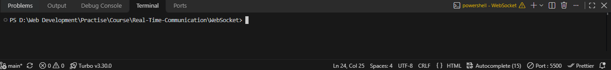
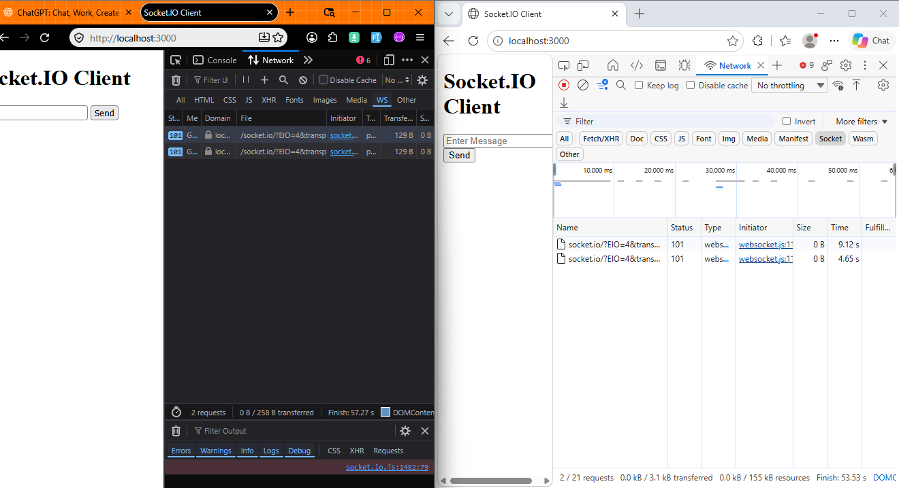
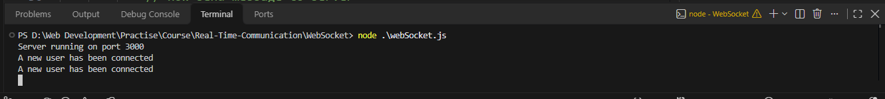
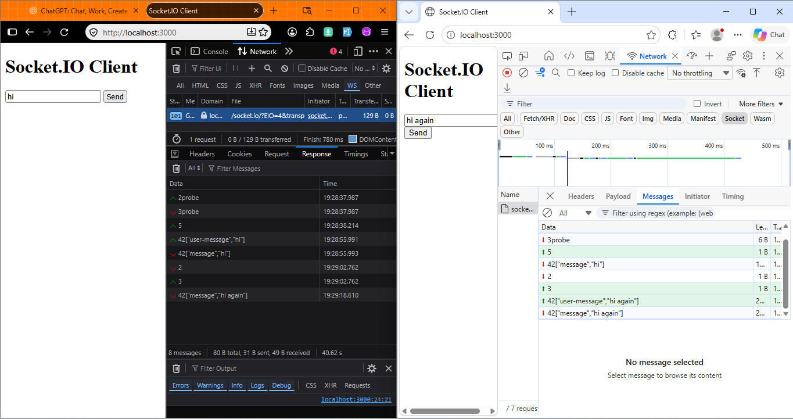

# Multiple Users and Message Broadcasting with Socket.IO

## Overview

In this practice, I continued from the previous Socket.IO project.

Previously, I connected one browser client to the server and sent messages from that client to the server. In this practice, I opened the same application in two browser windows to understand how multiple clients connect to one Socket.IO server.

I also implemented message broadcasting. When one client sends a message to the server, the server uses `io.emit()` to send that message to all connected clients.

**What this practice implements:**

- Connecting multiple browser clients to one Socket.IO server.
- Detecting each new client connection.
- Understanding that each client has its own `socket` object and socket ID.
- Sending a message from a client to the server with `socket.emit()`.
- Receiving that message on the server with `socket.on()`.
- Broadcasting the message from the server to all connected clients with `io.emit()`.
- Receiving the broadcast event in the browser with `socket.on()`.

**Important:** This is a basic broadcast practice. It does not yet implement usernames, private messages, chat rooms, message history, or a complete chat interface.

## Technologies Used

- Node.js
- Express
- Node.js HTTP module
- Socket.IO
- JavaScript
- HTML

## 1. Project Setup

The project already has Express and Socket.IO installed. If you need to install them:

```bash
npm install express socket.io
```

The project uses ES modules through this setting in `package.json`:

```json
"type": "module"
```

## 2. Project Structure

The existing folder structure is kept. No `public` folder is created.

```text
Real-Time-Communication/
│
├── node_modules/
└── WebSocket/
    ├── client1.html
    └── webSocket.js
```

Open the terminal inside the `WebSocket` folder and run the server:

```bash
node .\webSocket.js
```

The paths used in the server code below are resolved relative to this `WebSocket` working directory.

## 3. Understanding the Server Code Step by Step

### Step 1: Import the required packages

**Server — `webSocket.js`**

```js
import express from "express";
import http from "node:http";
import path from "node:path";
import { Server } from "socket.io";
```

**Explanation:**

- `express` imports Express, which we use to handle HTTP requests and responses.
- `node:http` imports Node.js's built-in HTTP module. We use it to create the HTTP server.
- `node:path` imports Node.js's path module. We use it to resolve filesystem paths.
- `Server` imports the Socket.IO server class.

### Step 2: Create the Express application

```js
const app = express();
```

This creates the Express application. We use `app` to register middleware and HTTP routes.

### Step 3: Create the HTTP server

```js
const server = http.createServer(app);
```

This creates a Node.js HTTP server and passes the Express application to it.

Express handles the HTTP requests received by this server. We create the HTTP server explicitly because Socket.IO will attach to the same server.

### Step 4: Attach Socket.IO to the HTTP server

```js
const io = new Server(server);
```

This creates a Socket.IO server and attaches it to our HTTP server.

- `server` is the HTTP server.
- `io` is the Socket.IO server instance.

The same HTTP server can now serve the webpage through Express and handle Socket.IO connections.

### Step 5: Listen for client connections and messages

```js
io.on("connection", (socket) => {
    console.log("A new user has been connected");

    socket.on("user-message", (message) => {
        console.log("A new User message", message);

        io.emit("message", message);
    });
});
```

**Explanation:**

- `io.on("connection", ...)` listens for new Socket.IO client connections.
- Every time a client connects successfully, Socket.IO runs this callback.
- Socket.IO provides a `socket` object for that specific client connection.
- `socket.on("user-message", ...)` listens for the `"user-message"` event from this particular client.
- The `message` parameter contains the data sent by that client.
- `io.emit("message", message)` sends a `"message"` event with the received message to **all connected clients**, including the client that originally sent it.

**Important difference:**

- `socket.emit(...)` sends an event to one particular socket connection.
- `io.emit(...)` broadcasts an event to all connected sockets.

### Step 6: Serve static files from the WebSocket folder

```js
app.use(express.static(path.resolve("./WebSocket")));
```

**Explanation:**

- `path.resolve(".")` resolves the current working directory to an absolute filesystem path.
- `express.static(...)` is middleware that serves static files from that directory.
- `app.use(...)` registers the middleware in Express.

We run the server while the terminal is inside the `WebSocket` folder, so this serves files from that folder.

### Step 7: Handle the homepage request

```js
app.get("/", (req, res) => {
    return res.sendFile(path.resolve("client1.html"));
});
```

**Explanation:**

- `app.get("/")` handles an HTTP GET request for the homepage.
- `req` represents the incoming request.
- `res` is used to send a response.
- `res.sendFile(...)` sends `client1.html` to the browser.

### Step 8: Start the server

```js
server.listen(3000, () => {
    console.log("Server running on port 3000");
});
```

This starts the HTTP server on port `3000`. The server is now ready to serve the HTML page and accept Socket.IO client connections.

## 4. Complete Server Code

**`webSocket.js`**

```js
import express from "express";
import http from "node:http";
import path from "node:path";
import { Server } from "socket.io";

const app = express();

const server = http.createServer(app);

const io = new Server(server);

// Listen for new client connections.
io.on("connection", (socket) => {
    console.log("A new user has been connected");

    // Listen for a message event from this particular client.
    socket.on("user-message", (message) => {
        console.log("A new User message", message);

        // Broadcast the received message to all connected clients.
        io.emit("message", message);
    });
});

// Serve static files from the current WebSocket folder.
app.use(express.static(path.resolve("./WebSocket")));

// Send client1.html when the browser requests the homepage.
app.get("/", (req, res) => {
    return res.sendFile(path.resolve("client1.html"));
});

// Start the HTTP server on port 3000.
server.listen(3000, () => {
    console.log("Server running on port 3000");
});
```

**Note:** In my earlier code, I had written `io.on("connection", ...)` twice: one listener logged the connection, and another listened for messages. The complete code above combines both tasks into one connection handler so the connection logic is easier to follow.

## 5. Understanding the Client Code Step by Step

### Step 1: Create the input and Send button

```html
<input type="text" id="message" placeholder="Enter Message">
<button id="sendBtn">Send</button>
```

- The input allows the user to type a message.
- `id="message"` lets JavaScript find the input.
- `id="sendBtn"` lets JavaScript find the Send button.

### Step 2: Load the Socket.IO client library

```html
<script src="/socket.io/socket.io.js"></script>
```

This loads the Socket.IO browser client library provided by our Socket.IO server. It makes the `io()` function available in the browser.

### Step 3: Connect automatically when the page loads

```js
const socket = io();
```

This creates a Socket.IO client and starts connecting to the server that served the page.

Because this line is not inside a button-click function, it runs when the browser executes the script. Reloading the page creates a new client connection.

### Step 4: Get the HTML elements

```js
messageInput = document.getElementById("message");
sendBtn = document.getElementById("sendBtn");
```

- `document.getElementById("message")` gets the input element.
- `document.getElementById("sendBtn")` gets the button element.

In the improved complete code below, both variables are declared with `const`.

### Step 5: Listen for messages broadcast by the server

```js
socket.on("message", (message) => {
    console.log("Message from server:", message);
});
```

- `socket.on("message", ...)` listens for an event named `"message"` from the server.
- The `message` parameter contains the data sent with that event.
- `console.log()` prints the received message in the browser console.

**Small correction to my first test:** I initially wrote `console.log()` without passing `message`. That would not display the received message. To see it, pass the `message` variable to `console.log()` as shown above.

### Step 6: Read the input when Send is clicked

```js
sendBtn.addEventListener("click", (e) => {
    const message = messageInput.value;
    console.log(message);

    socket.emit("user-message", message);
});
```

- `addEventListener("click", ...)` runs the callback when the user clicks Send.
- `messageInput.value` reads the text from the input field.
- `console.log(message)` prints the typed value in the browser console.
- `socket.emit("user-message", message)` sends the `"user-message"` event and its data to the server.

## 6. Complete Client Code

**`client1.html`**

```html
<!DOCTYPE html>
<html lang="en">

<head>
    <meta charset="UTF-8">
    <title>Socket.IO Client</title>
</head>

<body>

    <h1>Socket.IO Client</h1>

    <input type="text" id="message" placeholder="Enter Message">
    <button id="sendBtn">Send</button>

    <!-- Load the Socket.IO client library provided by the server. -->
    <script src="/socket.io/socket.io.js"></script>

    <script>
        // Create a Socket.IO connection automatically when this page loads.
        const socket = io();

        // Get the input and Send button elements.
        const messageInput = document.getElementById("message");
        const sendBtn = document.getElementById("sendBtn");

        // Listen for messages broadcast by the server.
        socket.on("message", (message) => {
            console.log("Message from server:", message);
        });

        // When Send is clicked, read the input and send it to the server.
        sendBtn.addEventListener("click", (e) => {
            const message = messageInput.value;
            console.log(message);

            // Send the message to the server.
            socket.emit("user-message", message);
        });
    </script>

</body>

</html>
```

## 7. What Happens When Two Clients Connect?

For this practice, I opened the same page in two separate browser windows.

Both pages use:

```js
const socket = io();
```

Each browser page creates its own Socket.IO client connection.

The server's connection callback runs once for each successfully connected client. That means two connected browser clients produce two connection callbacks and two separate server-side `socket` objects.

### A. Before starting the server

The terminal is open inside the `WebSocket` folder.



### B. Open the page in two browsers

I opened `http://localhost:3000` in two browser windows. The Network tabs show a Socket.IO WebSocket connection for each browser.



### C. Server detects both clients

When both browser clients connect, the server prints the connection message twice.

Expected terminal output:

```text
Server running on port 3000
A new user has been connected
A new user has been connected
```



## 8. How Broadcasting Works

Suppose two clients are connected:

- Client 1 is open in the first browser.
- Client 2 is open in the second browser.

Client 1 types `hi` and clicks Send.

### Step 1: Client 1 sends the event to the server

```js
socket.emit("user-message", "hi");
```

### Step 2: The server receives it

```js
socket.on("user-message", (message) => {
    console.log("A new User message", message);
});
```

The server receives `"hi"`.

### Step 3: The server broadcasts it

```js
io.emit("message", message);
```

`io.emit()` sends the `"message"` event to every currently connected client.

That includes Client 1 (the sender) and Client 2 (the other connected client).

### Step 4: Both clients listen for the broadcast

```js
socket.on("message", (message) => {
    console.log("Message from server:", message);
});
```

Both browser clients receive the event and print the message in their own browser consoles.

### Screenshot: Messages sent by both clients

I tested messages from the two browser windows and inspected the Socket.IO messages in the Network tab.



## 9. Complete Communication Flow

```text
          CLIENT 1                  SERVER                  CLIENT 2
              |                        |                        |
              |--- Connect ------------>|                        |
              |                        |<------------ Connect ---|
              |                        |                        |
              |                 Two connections                  |
              |                        |                        |
              |                        |                        |
       User types "hi"                 |                        |
              |                        |                        |
       socket.emit(                    |                        |
         "user-message", "hi"           |                        |
       ) ----------------------------->|                        |
              |                 socket.on(...)                   |
              |                 receives "hi"                    |
              |                        |                        |
              |                 io.emit("message", "hi")         |
              |<-----------------------|------------------------>|
              |                        |                        |
       socket.on("message")     Broadcast to all          socket.on("message")
       receives "hi"             connected clients         receives "hi"
              |                        |                        |
```

## 10. Important Concepts Learned

| Concept | Meaning |
|---|---|
| `io()` | Creates a Socket.IO client and starts connecting to the server |
| `io.on("connection", ...)` | Server event that runs for each newly connected client |
| `socket` | Represents one individual client connection on the server |
| `socket.id` | Unique identifier for a Socket.IO connection |
| `socket.emit()` | Sends an event through one client's connection |
| `socket.on()` | Listens for a named event |
| `io.emit()` | Broadcasts an event to all currently connected clients |
| `"user-message"` | Event name used by the client to send a message to the server |
| `"message"` | Event name used by the server to broadcast a message to clients |

### `socket.emit()` vs. `io.emit()`

| Code | Where it is used | Who receives it? |
|---|---|---|
| `socket.emit("event", data)` | Server-side socket | The client represented by that socket |
| `io.emit("event", data)` | Socket.IO server | All currently connected clients, including the sender |

In this project, the browser uses `socket.emit()` to send a message to the server. The server uses `io.emit()` to broadcast that message to all connected clients.

## 11. Project Status

**Completed:**

- Created an Express application and HTTP server.
- Attached Socket.IO to the HTTP server.
- Served the HTML page through Express.
- Connected multiple browser clients to one Socket.IO server.
- Detected each client connection on the server.
- Sent a message from a client to the server.
- Received the message on the server.
- Broadcast the message to all connected clients using `io.emit()`.
- Received the broadcast event in the browser clients.

**Not implemented yet:**

- Showing messages inside the webpage instead of only the browser console.
- Sending a message to one specific client only.
- Usernames and identifying users by name.
- Chat rooms.
- Handling and displaying client disconnections.
- Saving chat messages in a database.
